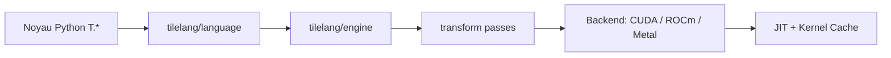

# tile-ai/tilelang

> Dedicated Python language for writing GPU/CPU kernels (GEMM, attention) on top of TVM.

## The problem
Writing high-performance GPU kernels by hand in CUDA is slow and vendor-locked.

## What it actually does
Pythonic DSL (`@tilelang.jit`, `T.Kernel`, `T.gemm`, `T.Pipelined`) compiled through an IR pipeline to CUDA, ROCm, Metal, CPU (LLVM) and WebGPU. Includes autotuning, a kernel cache, FlashAttention examples, DeepSeek MLA/V3.2/V4. The README cites benchmarks on H100, A100, MI300X, RTX 4090.

## How it is wired


## Trying it
```bash
pip install tilelang
python -c "import tilelang; print(tilelang.__version__)"
pip install tilelang --find-links https://tile-ai.github.io/whl/nightly
```

## Cost and gotchas
Free; a GPU is required for execution. Nightly versions may be unstable. License not identified by GitHub. 313 open issues.

## What it is not
Not a model library: it is a kernel compiler, you need to know GPU tiling.

## Alternatives
No alternative named in the README (TVM is cited as the base).

## For you
Worth watching: useful if you optimize inference and attention kernels; otherwise too low-level.
