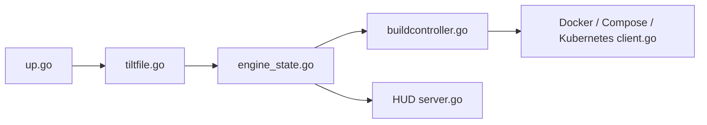

# tilt-dev/tilt

> Local development orchestrator for multi-service applications on Kubernetes or Docker Compose.

## The problem
Between a code change and a new running process, you have to rebuild, redeploy and follow the logs of many services.

## What it actually does
`tilt up` evaluates a `Tiltfile`, watches files, builds images or commands, updates Kubernetes or Compose and exposes state and logs in a local web HUD.

## How it is wired


## Trying it
```bash
curl -fsSL https://raw.githubusercontent.com/tilt-dev/tilt/master/scripts/install.sh | bash
tilt up
```

## Cost and gotchas
Free. You need a cluster or Docker Compose. Installation by script piped to bash.

## What it is not
Not a production deployment tool: the slogan says "Kubernetes for Prod, Tilt for Dev".

## Alternatives
No alternative named in the README.

## For you
Worth watching: useful for iterating locally on inference services on Kubernetes, of no interest if you have no microservices.
