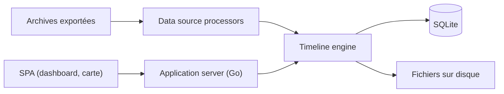

# timelinize/timelinize

> Local application that merges photos, messages, locations and accounts into a personal timeline.

## The problem
The data of a life is scattered across proprietary services that can be lost overnight.

## What it actually does
Imports export archives (Google Takeout, social networks, messaging apps, GPX, contacts) without manual unzipping, indexes them in SQLite and files them by date. Web interface with timeline, map, gallery and conversation views; HTTP API symmetric with the CLI. Repeated imports skip duplicates.

## How it is wired


## Trying it
```bash
timelinize help
go run main.go help
```

## Cost and gotchas
Free, entirely local. The schema evolves: timelines must be recreated at each update, and the original source data must be kept.

## What it is not
Not a cloud service or a stable tool: the README speaks of active development and "unstable". The screenshots are in demo mode and outdated.

## Alternatives
- No alternative cited in the README.

## For you
Worth watching: interesting for personal data sovereignty and multi-source ingestion, but too unstable to rely on today.
