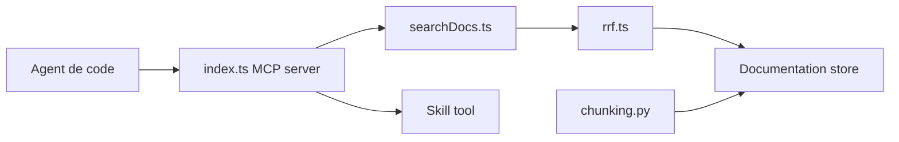

# timescale/pg-aiguide

> PostgreSQL skills and documentation search so coding agents write better SQL schemas.

## The problem
Assistants generate dated Postgres, without suitable constraints or indexes.

## What it actually does
Provides best-practice Skills (schema, indexes, types, integrity, naming, performance) and a public MCP server with `search_docs`: semantic and BM25 search across the PostgreSQL manuals (per version), TimescaleDB and PostGIS, plus `view_skill`. The demo example claims 4x more constraints and 55% more indexes. Ingestion scrapes, chunks and indexes the docs.

## How it is wired


## Trying it
```bash
npx skills add timescale/pg-aiguide --skill postgres
claude plugin marketplace add timescale/pg-aiguide
claude plugin install pg@aiguide
```

## Cost and gotchas
Free; the public MCP server (mcp.tigerdata.com) is hosted by TigerData: your queries go through it. The Skills alone work without it.

## What it is not
Not a database tool: it does not run against your database. The demo figures come from a single test.

## Alternatives
No alternative named in the README.

## For you
Adopt: installing the Skills costs one command and improves the schemas your agents generate; the public MCP remains optional.
