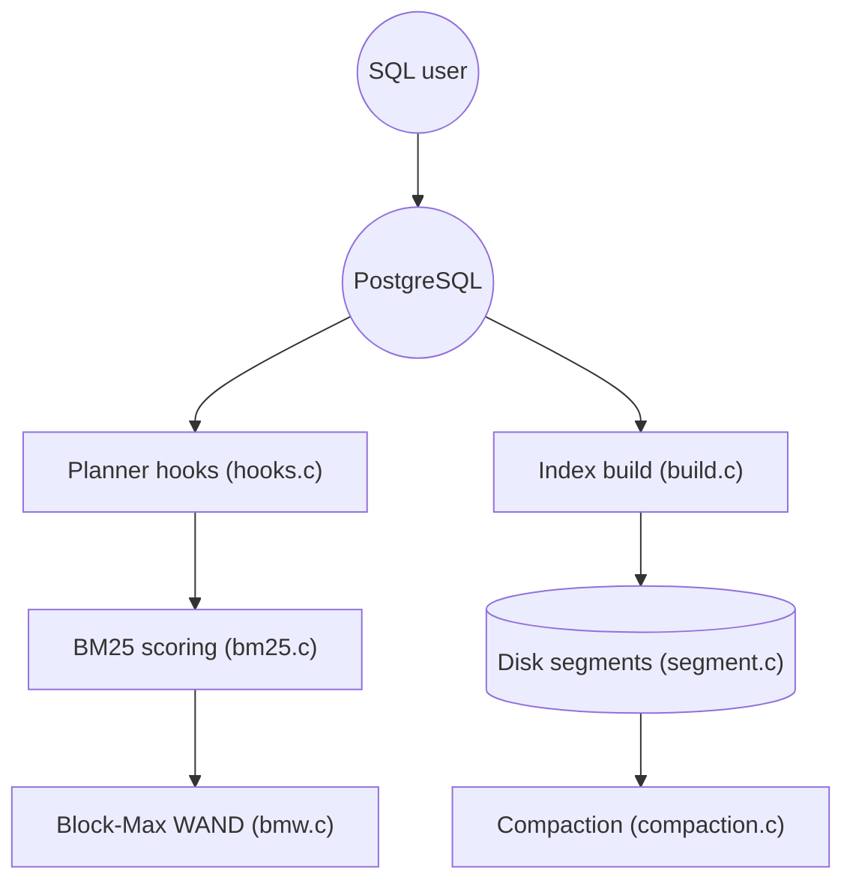

# timescale/pg_textsearch

> PostgreSQL extension for BM25-ranked full-text search, for search applications and RAG.

## The problem
PostgreSQL's native search ranks results poorly, which pushes you to add a separate search engine.

## What it actually does
Adds a `bm25` index and the `<@>` operator to sort by relevance (`k1` and `b` tunable, PostgreSQL text configurations). Handles expression, partial and partitioned indexes, `@@` boolean filtering and top-k with Block-Max WAND. Online compaction, manual or in the background.

## How it is wired


## Trying it
```bash
git clone https://github.com/timescale/pg_textsearch
cd pg_textsearch
make
make install
```
```sql
CREATE EXTENSION pg_textsearch;
CREATE INDEX docs_idx ON documents USING bm25(content) WITH (text_config='english');
SELECT * FROM documents ORDER BY content <@> 'database system' LIMIT 5;
```

## Cost and gotchas
Free, but PostgreSQL 17 or 18 is required, and the extension must be in `shared_preload_libraries` with a restart. BM25 statistics are local to each partition. `PREPARE TRANSACTION` is not supported.

## What it is not
It is not vector search: it is lexical (BM25). Roles protected by RLS leak term-frequency statistics.

## Alternatives
No alternative named in the README (Elastic is cited only in a comparison of limits).

## For you
Adopt it if your RAG stack is already on PostgreSQL: BM25 inside the database avoids one more search engine, to be combined with pgvector.
