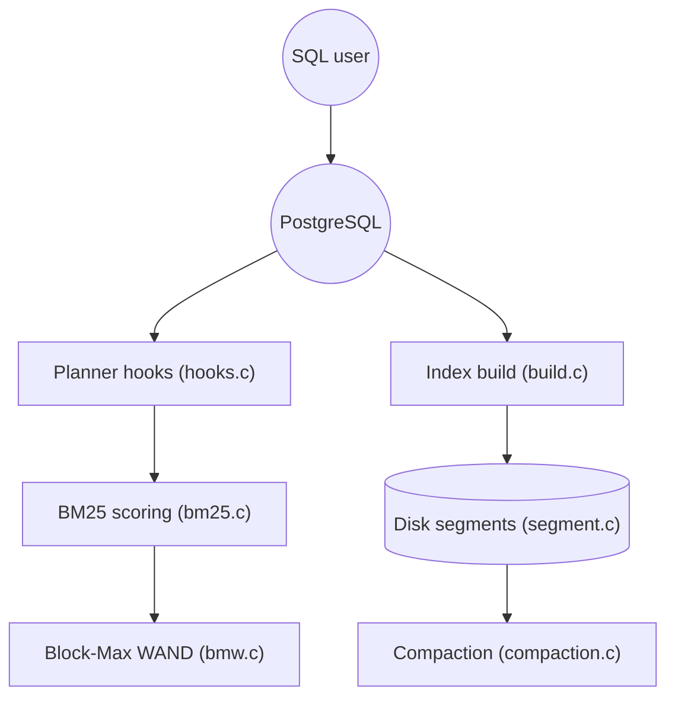

# timescale/pg_textsearch

> Extension PostgreSQL de recherche plein texte classée par BM25, pour applications de recherche et RAG.

## Le problème
La recherche native de PostgreSQL classe mal les résultats, ce qui pousse à ajouter un moteur de recherche séparé.

## Ce que ça fait vraiment
Ajoute un index `bm25` et l'opérateur `<@>` pour trier par pertinence (`k1` et `b` réglables, configurations de texte PostgreSQL). Gère index d'expression, partiels et partitionnés, filtrage booléen `@@` et top-k par Block-Max WAND. Compaction en ligne, manuelle ou en arrière-plan.

## Comment c'est branché


## Essayer
```bash
git clone https://github.com/timescale/pg_textsearch
cd pg_textsearch
make
make install
```
```sql
CREATE EXTENSION pg_textsearch;
CREATE INDEX docs_idx ON documents USING bm25(content) WITH (text_config='english');
SELECT * FROM documents ORDER BY content <@> 'database system' LIMIT 5;
```

## Coût et pièges
Gratuit, mais PostgreSQL 17 ou 18 est requis, et l'extension doit être dans `shared_preload_libraries` avec redémarrage. Les statistiques BM25 sont locales par partition. `PREPARE TRANSACTION` n'est pas supporté.

## Ce que ce n'est pas
Ce n'est pas de la recherche vectorielle : c'est du lexical (BM25). Les rôles protégés par RLS laissent fuir des statistiques de fréquence de termes.

## Alternatives
Aucune alternative nommée dans le README (Elastic y est cité seulement en comparaison de limites).

## Pour toi
À adopter si ta stack RAG est déjà sur PostgreSQL : un BM25 dans la base évite un moteur de recherche en plus, à combiner avec pgvector.

