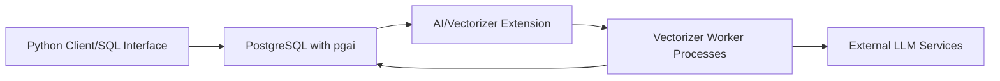

# timescale/pgai

> Python library that automatically syncs embeddings in PostgreSQL for RAG.

## The problem
Keeping embeddings up to date as data changes requires queues, workers and handling of embedding API failures.

## What it actually does
`ai.create_vectorizer()` declares a pipeline in SQL: loading (column or S3 file), parsing, chunking, formatting, embedding.
Stateless workers process the queue and write the embeddings; application writes do not depend on them.
Search via pgvector / pgvectorscale; a "Semantic Catalog" for text-to-SQL.

## How it is wired


## Trying it
```bash
pip install pgai
pgai install -d <database-url>
pip install "pgai[vectorizer-worker]"
```

## Cost and gotchas
Embedding provider key at your expense (OpenAI in the quickstart); a worker to run yourself outside Timescale Cloud.

## What it is not
No longer maintained since February 2026, repository archived: no fixes to expect.

## Alternatives
No alternative named in the README (pgvector and pgvectorscale are dependencies of it).

## For you
Ignore for a new project: the declarative vectorizer idea is good, but building a RAG on an archived project is guaranteed debt.
