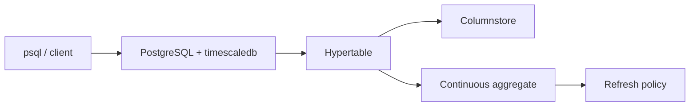

# timescale/timescaledb

> PostgreSQL extension for real-time analytics on time series and events, for data teams.

## The problem
Storing and querying millions of timestamped points in PostgreSQL becomes slow without partitioning or columnar storage.

## What it actually does
Turns a table into a time-partitioned hypertable, with columnstore (compression, direct writes), `time_bucket`, continuous aggregates with incremental refresh, and refresh policies. A hosted offering, Tiger Cloud, is provided alongside.

## How it is wired


## Trying it
```bash
curl -sL https://tsdb.co/start-local | sh
docker run -d --name timescaledb -p 6543:5432 -e POSTGRES_PASSWORD=password timescale/timescaledb-ha:pg18
psql -h localhost -p 6543 -U postgres
```

## Cost and gotchas
Docker and 8 GB of RAM recommended. The one-line script is for local dev only. Example password to be changed.

## What it is not
Not a separate database: it is extended PostgreSQL. The license is present but not identified by GitHub, to be reread before commercial use. Not the managed cloud version.

## Alternatives
No alternative named; the README compares to PostgreSQL and its materialized views.

## For you
Adopt for monitoring or IoT in SQL: you keep PostgreSQL and gain compression and aggregates; check the license.
