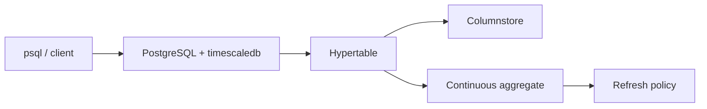

# timescale/timescaledb

> Extension PostgreSQL pour l'analytique temps réel sur séries temporelles et événements, pour équipes data.

## Le problème
Stocker et interroger des millions de points horodatés dans PostgreSQL devient lent sans partitionnement ni stockage colonne.

## Ce que ça fait vraiment
Transforme une table en hypertable partitionnée par temps, avec columnstore (compression, écriture directe), `time_bucket`, agrégats continus à rafraîchissement incrémental et politiques de rafraîchissement. Une offre hébergée, Tiger Cloud, est proposée à côté.

## Comment c'est branché


## Essayer
```bash
curl -sL https://tsdb.co/start-local | sh
docker run -d --name timescaledb -p 6543:5432 -e POSTGRES_PASSWORD=password timescale/timescaledb-ha:pg18
psql -h localhost -p 6543 -U postgres
```

## Coût et pièges
Docker et 8 Go de RAM recommandés. Le script one-line est réservé au dev local. Mot de passe d'exemple à changer.

## Ce que ce n'est pas
Pas une base séparée : c'est PostgreSQL étendu. La licence est présente mais non identifiée par GitHub, à relire avant un usage commercial. Pas la version cloud gérée.

## Alternatives
Aucune alternative nommée ; le README compare à PostgreSQL et à ses vues matérialisées.

## Pour toi
Adopter pour du monitoring ou de l'IoT en SQL : tu gardes PostgreSQL et gagnes compression et agrégats ; vérifie la licence.

