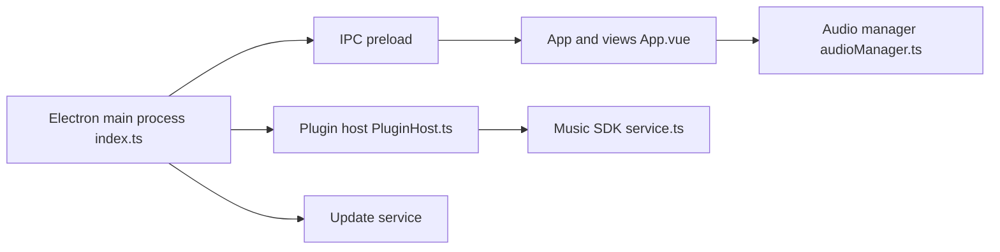

# timeshiftsauce/CeruMusic

> Electron/Vue desktop music player, where music sources come from plugins installed by the user.

## The problem
Having an extensible desktop player, without the app bundling or providing music sources itself.

## What it actually does
Electron 44 and Vue 3 (TypeScript, Pinia, Vite). Plugin framework (CeruPlugins), local playlist, lyrics and covers via plugins, virtual list, automatic updates. A floating AI assistant appears in the tree. Windows, macOS and Linux builds.

## How it is wired


## Trying it
```bash
yarn setup
yarn dev
yarn build:linux
```

## Cost and gotchas
Free. Use Yarn 1.22.22 and `yarn setup`, not `yarn install`. Node 22.14+. The README is in Chinese. Plugins are for you to find and audit yourself.

## What it is not
Not a music service: no source provided. The README declares AGPL v3 but restricts use to non-commercial purposes, which departs from a free license. GitHub does not recognize the license.

## Alternatives
No alternative named in the README.

## For you
Ignore: music player unrelated to data/AI work, and an ambiguous license with plugins whose legality is on you.
