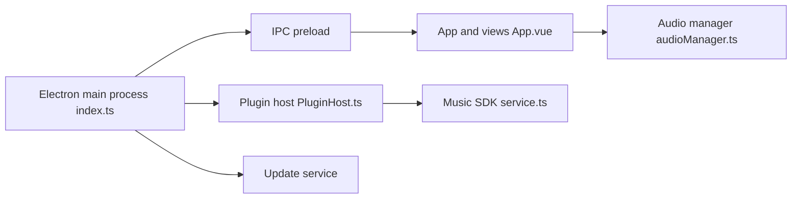

# timeshiftsauce/CeruMusic

> Lecteur de musique de bureau Electron/Vue, où les sources de musique viennent de plugins installés par l'utilisateur.

## Le problème
Disposer d'un lecteur de bureau extensible, sans que l'appli embarque ni fournisse elle-même de sources musicales.

## Ce que ça fait vraiment
Électron 44 et Vue 3 (TypeScript, Pinia, Vite). Cadre de plugins (CeruPlugins), liste de lecture locale, paroles et pochettes via plugins, liste virtuelle, mises à jour automatiques. Un assistant IA flottant apparaît dans l'arborescence. Builds Windows, macOS et Linux.

## Comment c'est branché


## Essayer
```bash
yarn setup
yarn dev
yarn build:linux
```

## Coût et pièges
Gratuit. Utiliser Yarn 1.22.22 et `yarn setup`, pas `yarn install`. Node 22.14+. Le README est en chinois. Les plugins sont à trouver et à auditer soi-même.

## Ce que ce n'est pas
Pas un service de musique : aucune source fournie. Le README déclare AGPL v3 mais restreint l'usage à des fins non commerciales, ce qui s'écarte d'une licence libre. GitHub ne reconnaît pas la licence.

## Alternatives
Aucune alternative nommée dans le README.

## Pour toi
Ignorer : lecteur de musique sans rapport avec un travail data/IA, et licence ambiguë avec des plugins dont la légalité repose sur toi.

