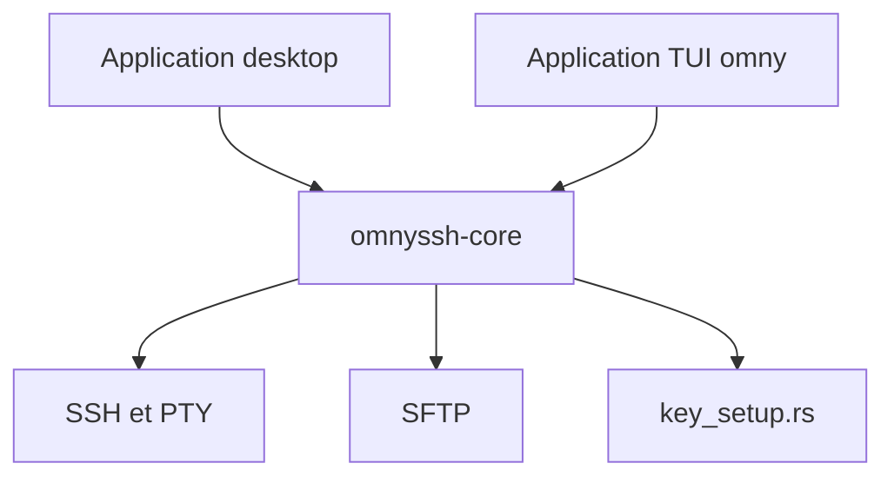

# timhartmann7/omnyssh

> Desktop or terminal application for managing your servers: dashboard, terminals, SFTP and snippets.

## The problem
Juggling several SSH terminals, `scp` and repeated commands on each server is slow.

## What it actually does
Each server appears as a card with CPU, RAM, disk, top processes and number of Docker containers. One click opens a real PTY terminal or a two-pane SFTP browser. Parameterized snippets can be sent to several hosts. A one-click SSH key setup generates an Ed25519 key, tests the connection, then turns off password login. No account, no telemetry, according to the README.

## How it is wired
Simplified diagram based on the fiche, no diagram provided.



## Trying it
```bash
curl -fsSL https://raw.githubusercontent.com/timhartmann7/omnyssh/main/install.sh | sh
cargo install omnyssh
omny
```

## Cost and gotchas
Free. The install script is run straight from curl. The key setup turns off password login with no intermediate confirmation: read `key_setup.rs` before using it in production.

## What it is not
It is not a long-term server monitoring tool: it is an SSH client. The RAM figures against Termius come from the author, measured on a Mac M4.

## Alternatives
Termius for a proprietary offer with an account; tmux plus ssh for the lightest option.

## For you
Worth watching: handy for administering a few GPU or inference servers, but the project is only a few months old and has a single maintainer.
