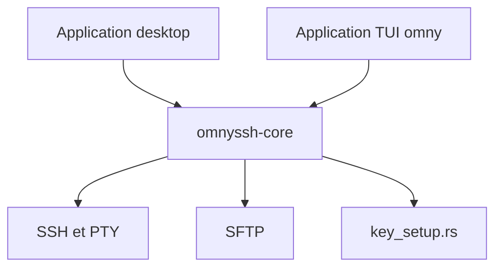

# timhartmann7/omnyssh

> Application bureau ou terminal pour gérer ses serveurs : tableau de bord, terminaux, SFTP et snippets.

## Le problème
Jongler entre plusieurs terminaux SSH, `scp` et des commandes répétées sur chaque serveur est lent.

## Ce que ça fait vraiment
Chaque serveur apparaît en carte avec CPU, RAM, disque, processus principaux et nombre de conteneurs Docker. Un clic ouvre un vrai terminal PTY ou un navigateur SFTP à deux panneaux. Les snippets paramétrés s'envoient à plusieurs hôtes. Une configuration de clé SSH en un clic génère une clé Ed25519, teste la connexion, puis coupe le mot de passe. Pas de compte, pas de télémétrie, d'après le README.

## Comment c'est branché
Schéma simplifié d'après la fiche, sans diagramme fourni.



## Essayer
```bash
curl -fsSL https://raw.githubusercontent.com/timhartmann7/omnyssh/main/install.sh | sh
cargo install omnyssh
omny
```

## Coût et pièges
Gratuit. Le script d'installation est exécuté depuis curl. La configuration de clé coupe le login par mot de passe sans confirmation intermédiaire : lire `key_setup.rs` avant de l'utiliser en production.

## Ce que ce n'est pas
Ce n'est pas un outil de supervision serveur à long terme : c'est un client SSH. Les chiffres de RAM face à Termius viennent de l'auteur, mesurés sur un Mac M4.

## Alternatives
Termius pour une offre propriétaire avec compte ; tmux plus ssh pour le plus léger.

## Pour toi
À surveiller : pratique pour administrer quelques serveurs GPU ou d'inférence, mais le projet n'a que quelques mois et un seul mainteneur.

