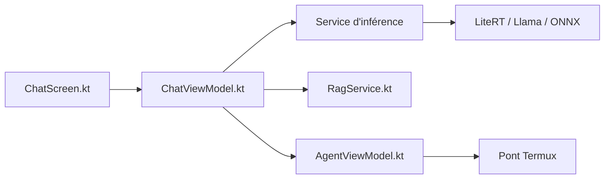

# timmyy123/LLM-Hub

> Mobile and desktop app for running chat, image, video and music locally on-device.

## The problem
Using generative models without cloud, without an account and without sending your data.

## What it actually does
Downloads or imports models (.task, .litertlm, .gguf), then offers chat with RAG memory and web search, an agent with tools and Termux commands, image, video and music generation, speech synthesis, transcription, translation. GPU and NPU acceleration. Android, iOS, then Windows, macOS, Linux.

## How it is wired


## Trying it
```bash
git clone https://github.com/timmyy123/LLM-Hub.git
cd LLM-Hub/android
./gradlew assembleDebug
./gradlew installDebug
```

## Cost and gotchas
Models weigh several GB and need RAM. A premium option and ads exist (a dev flag removes them). The Windows installers are not signed. HuggingFace token for private models.

## What it is not
Not a library: it is an application. The diagram's links describe the documented path, not verified calls.

## Alternatives
No alternative named in the README.

## For you
Worth watching: a useful showcase of local models on mobile, but the license needs checking and the project is carried by one person.
