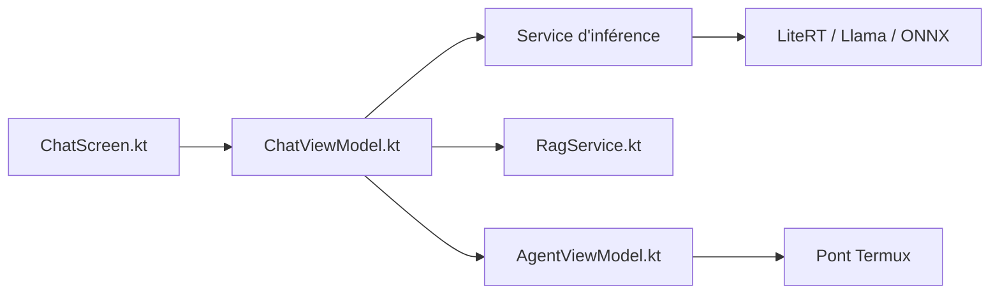

# timmyy123/LLM-Hub

> Application mobile et bureau pour faire tourner chat, image, vidéo et musique en local sur appareil.

## Le problème
Utiliser des modèles génératifs sans cloud, sans compte et sans envoyer ses données.

## Ce que ça fait vraiment
Télécharge ou importe des modèles (.task, .litertlm, .gguf), puis chat avec mémoire RAG et recherche web, agent avec outils et commandes Termux, génération d'images, de vidéo et de musique, synthèse vocale, transcription, traduction. Accélération GPU et NPU. Android, iOS, puis Windows, macOS, Linux.

## Comment c'est branché


## Essayer
```bash
git clone https://github.com/timmyy123/LLM-Hub.git
cd LLM-Hub/android
./gradlew assembleDebug
./gradlew installDebug
```

## Coût et pièges
Les modèles pèsent plusieurs Go et demandent de la RAM. Une option premium et des publicités existent (drapeau de dev pour les lever). Les installeurs Windows ne sont pas signés. Jeton HuggingFace pour les modèles privés.

## Ce que ce n'est pas
Ce n'est pas une bibliothèque : c'est une application. Les liens du diagramme décrivent le parcours documenté, pas des appels vérifiés.

## Alternatives
Aucune alternative nommée dans le README.

## Pour toi
À surveiller : vitrine utile des modèles locaux sur mobile, mais licence à vérifier et projet porté par une personne.

