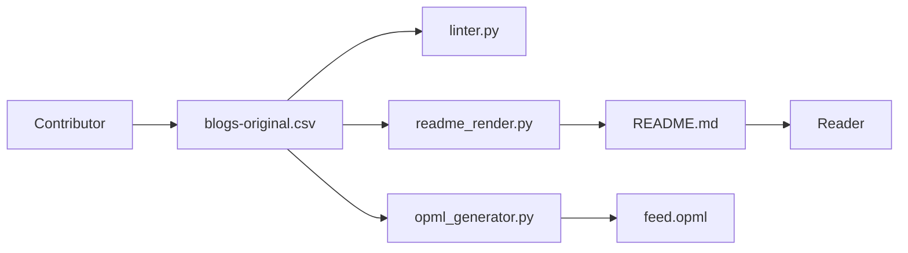

# timqian/chinese-independent-blogs

> Collaborative directory of Chinese personal blogs, with RSS feeds, for readers and the curious.

## The problem
Chinese independent blogs are overshadowed by platforms (public accounts, Zhihu, Weibo) and hard to discover. Without a list, a good personal blog stays invisible.

## What it actually does
A table of more than a thousand blogs: RSS feed link, description, address, tags (programming, security, AI, daily life…). Additions are made by PR on a CSV; the README and an OPML file are generated by scripts. An independent blog = its own domain and original content by the author.

## How it is wired


## Trying it
```bash
# Aucune commande d'installation documentée.
# Contribuer : ajouter une ligne à ./blogs-original.csv (nom, URL, RSS, tags), puis ouvrir une PR.
```

## Cost and gotchas
Free, nothing to install. Content almost entirely in Chinese; the quality and freshness of the listed blogs vary.

## What it is not
Neither an aggregator nor an RSS reader: the repository hosts no content. The README only mentions the idea of a future discovery tool. Tags are self-declared, not verified.

## Alternatives
No alternative named in the README (it only cites blog generators: Hexo, Hugo, Jekyll…).

## For you
Worth bookmarking if you read Chinese and want to feed an RSS reader with technical blogs (ML, systems); otherwise of no direct use for a data/MLOps profile.
