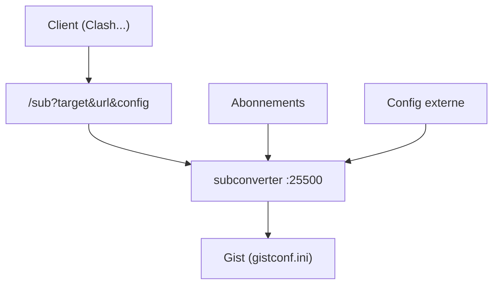

# tindy2013/subconverter

> Utility that converts between proxy subscription formats (Clash and others), exposed through a local HTTP interface.

## The problem
Proxy subscription formats differ from one client to another; they need to be converted and merged.

## What it actually does
A local service receives a `/sub?target=...&url=...` call and returns the converted subscription. Several subscriptions are merged with `|`. An external configuration is possible. Automatic upload to a Gist is provided with a personal token.

## How it is wired
Simplified diagram based on the fiche, no diagram provided.



## Trying it
```txt
http://127.0.0.1:25500/sub?target=%TARGET%&url=%URL%&config=%CONFIG%
```

## Cost and gotchas
Free (GPL-3.0). The last push dates from July 2026, so more than three months ago: no automatic alert for over a year, but worth watching. Subscription URLs and the Gist token are sensitive. The README refers to documentation in Chinese for advanced use.

## What it is not
Not a proxy client. Does not provide any subscription. The README targets a use outside the data / AI scope.

## Alternatives
None named in the README.

## For you
Ignore: proxy conversion tool unrelated to a data / AI / MLOps profile, and dependent on personal subscription data.
