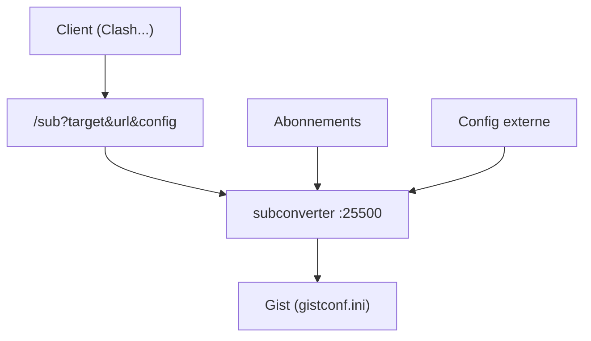

# tindy2013/subconverter

> Utilitaire qui convertit entre formats d'abonnements proxy (Clash et autres), exposé par une interface HTTP locale.

## Le problème
Les formats d'abonnement proxy diffèrent selon les clients ; il faut les convertir et les fusionner.

## Ce que ça fait vraiment
Un service local reçoit un appel `/sub?target=...&url=...` et renvoie l'abonnement converti. Plusieurs abonnements se fusionnent avec `|`. Une configuration externe est possible. Un envoi automatique vers un Gist est prévu avec un jeton personnel.

## Comment c'est branché
Schéma simplifié d'après la fiche, sans diagramme fourni.



## Essayer
```txt
http://127.0.0.1:25500/sub?target=%TARGET%&url=%URL%&config=%CONFIG%
```

## Coût et pièges
Gratuit (GPL-3.0). Le dernier push date de juillet 2026, soit plus de trois mois : pas d'alerte automatique de plus d'un an, mais à surveiller. Les URL d'abonnement et le jeton Gist sont sensibles. Le README renvoie à une documentation en chinois pour l'usage avancé.

## Ce que ce n'est pas
Pas un client proxy. Ne fournit aucun abonnement. Le README cible un usage hors du périmètre data / IA.

## Alternatives
Aucune nommée dans le README.

## Pour toi
À ignorer : outil de conversion de proxys sans rapport avec un profil data / IA / MLOps, et dépendant de données d'abonnement personnelles.

