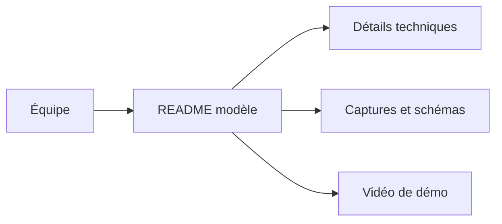

# tinkerhub/useless_project_temp

> Empty README template for the teams of the TinkerHub Useless Projects hackathon.

## The problem
Hackathon teams submit projects with no uniform presentation.

## What it actually does
A template to fill in: team names, description of the "problem that doesn't exist", technologies, installation, screenshots, diagrams, demo video and contributions. No code.

## How it is wired
Simplified diagram based on the fiche, no diagram provided.



## Trying it
```bash
# Aucune commande documentée : le README est un gabarit à remplir.
```

## Cost and gotchas
Free. No license declared. The content describes no real tool.

## What it is not
Not a project: it is a form. Nothing to run or reuse.

## Alternatives
No alternative named in the README.

## For you
Ignore: a simple hackathon template, no technical substance.
