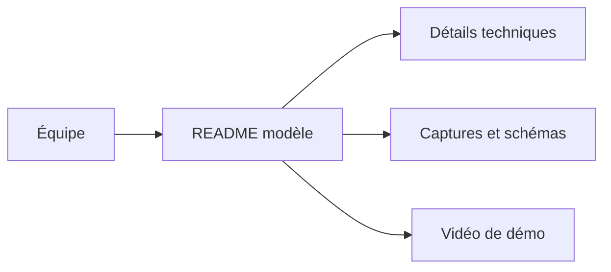

# tinkerhub/useless_project_temp

> Modèle de README vide pour les équipes du hackathon TinkerHub Useless Projects.

## Le problème
Des équipes de hackathon rendent des projets sans présentation homogène.

## Ce que ça fait vraiment
Un gabarit à remplir : noms d'équipe, description du « problème qui n'existe pas », technologies, installation, captures, schémas, vidéo de démo et contributions. Aucun code.

## Comment c'est branché
Schéma simplifié d'après la fiche, sans diagramme fourni.



## Essayer
```bash
# Aucune commande documentée : le README est un gabarit à remplir.
```

## Coût et pièges
Gratuit. Aucune licence déclarée. Le contenu ne décrit aucun outil réel.

## Ce que ce n'est pas
Ce n'est pas un projet : c'est un formulaire. Rien à exécuter ni à réutiliser.

## Alternatives
Aucune alternative nommée dans le README.

## Pour toi
À ignorer : simple gabarit de hackathon, aucune matière technique.

