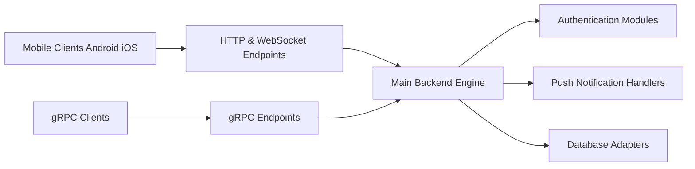

# tinode/chat

> Instant messaging server in Go, an open alternative to WhatsApp/Telegram.

## The problem
Messaging apps remain incompatible walled gardens; XMPP did not deliver on its promise of federation.

## What it actually does
Go server exposing WebSocket, long polling and gRPC; web, Android, iOS clients and a Python CLI.
Authentication modules (anon, basic, token, REST), push notifications, local or S3 media.
Database adapters for MySQL, PostgreSQL, MongoDB, RethinkDB; public sandbox.

## How it is wired

## Trying it
No command documented in the README (it points to the installation instructions).

## Cost and gotchas
Free when self-hosted; paid support offered. "Beta" quality according to the README.

## What it is not
Not XMPP-compatible, not a Slack replacement; federation only planned.

## Alternatives
No alternative named in the README.

## For you
Ignore: general-purpose messaging outside the data/ML scope.
