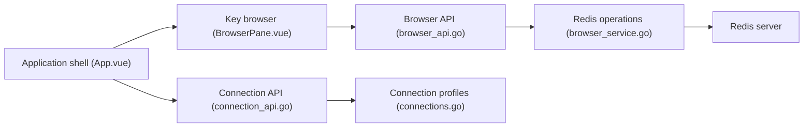

# tiny-craft/tiny-rdm

> Lightweight desktop manager for Redis, with a web version deployable via Docker.

## The problem
Browsing and editing Redis keys on the command line is laborious, especially with millions of keys.

## What it actually does
Wails application (Go + Vue). It manages connections (SSH tunnel, SSL, Sentinel, Cluster, HTTP and SOCKS5 proxies), browses keys with SCAN, offers CRUD on Redis types, value decoding and decompression, a CLI mode, command monitoring, the slow log, pub/sub, import/export. A credential-protected web version exists.

## How it is wired


## Trying it
```bash
go install github.com/wailsapp/wails/v2/cmd/wails@latest
git clone https://github.com/tiny-craft/tiny-rdm --depth=1
npm install --prefix ./frontend
wails dev
docker compose up -d     # version web, après création du docker-compose.yml du README
```

## Cost and gotchas
Free. Web version: set `ADMIN_USERNAME` and `ADMIN_PASSWORD`, and do not expose it without protection. On macOS, a quarantine command may be needed.

## What it is not
Not a Redis server administration or continuous monitoring tool. It remains a client.

## Alternatives
No alternative named in the README.

## For you
Worth watching: handy for inspecting a Redis cache or feature store; not essential.
