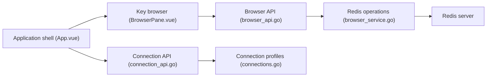

# tiny-craft/tiny-rdm

> Gestionnaire de bureau léger pour Redis, avec une version web déployable par Docker.

## Le problème
Parcourir et modifier des clés Redis en ligne de commande est laborieux, surtout avec des millions de clés.

## Ce que ça fait vraiment
Application Wails (Go + Vue). Elle gère les connexions (tunnel SSH, SSL, Sentinel, Cluster, proxys HTTP et SOCKS5), parcourt les clés avec SCAN, offre un CRUD sur les types Redis, un décodage et une décompression des valeurs, un mode CLI, la surveillance des commandes, le slow log, le pub/sub, l'import/export. Une version web protégée par identifiants existe.

## Comment c'est branché


## Essayer
```bash
go install github.com/wailsapp/wails/v2/cmd/wails@latest
git clone https://github.com/tiny-craft/tiny-rdm --depth=1
npm install --prefix ./frontend
wails dev
docker compose up -d     # version web, après création du docker-compose.yml du README
```

## Coût et pièges
Gratuit. Version web : définir `ADMIN_USERNAME` et `ADMIN_PASSWORD`, et ne pas l'exposer sans protection. Sur macOS, une commande de quarantaine peut être nécessaire.

## Ce que ce n'est pas
Pas un outil d'administration de serveur Redis ni de supervision continue. Il reste un client.

## Alternatives
Aucune alternative nommée dans le README.

## Pour toi
À surveiller : pratique pour inspecter un cache ou un feature store Redis ; non indispensable.

