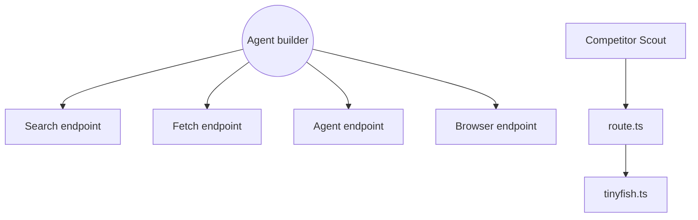

# tinyfish-io/tinyfish-cookbook

> Collection of recipes and demos built on the TinyFish web platform for AI agents.

## The problem
An agent that must search the web, read a page or get through a site without an API runs into noisy HTML and browsers to manage.

## What it actually does
A repository of independent projects, not a single application. It shows four TinyFish endpoints: Search and Fetch (free), Agent and Browser (billed by usage). It offers a REST interface, an MCP server, a CLI, Python and TypeScript SDKs, an agent skill and n8n flows. The recipes cover shopping, travel, monitoring and developer tools.

## How it is wired


## Trying it
```bash
npm install -g @tiny-fish/cli
tinyfish auth login
tinyfish search query "web automation tools"
pip install tinyfish
npx skills add github.com/tinyfish-io/tinyfish-cookbook --skill use-tinyfish
```

## Cost and gotchas
A TinyFish API key is required, account to create. Search and Fetch are free, Agent and Browser are billed. Community recipes are provided as is, with no guaranteed maintenance.

## What it is not
Not a reusable library: the recipes share no code. Not an open platform: the TinyFish service is a closed SaaS, only the repository is under MIT.

## Alternatives
The README cites Firecrawl as a tool that Fetch replaces, as well as Playwright for browser control.

## For you
To watch: concrete examples of agents that read the web, useful for automated research, but tied to one vendor.
