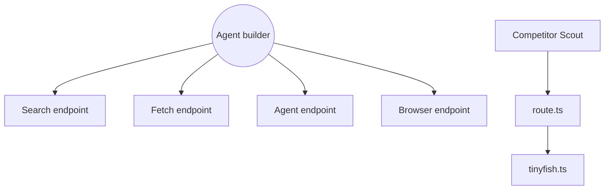

# tinyfish-io/tinyfish-cookbook

> Recueil de recettes et de démos construites sur la plateforme web TinyFish pour agents IA.

## Le problème
Un agent qui doit chercher sur le web, lire une page ou franchir un site sans API butte sur du HTML bruyant et des navigateurs à gérer.

## Ce que ça fait vraiment
Un dépôt de projets indépendants, pas une application unique. Il montre quatre points d'accès TinyFish : Search et Fetch (gratuits), Agent et Browser (facturés à l'usage). Il propose une interface REST, un serveur MCP, une CLI, des SDK Python et TypeScript, une compétence d'agent et des flux n8n. Les recettes couvrent achats, voyages, veille et outils de développement.

## Comment c'est branché


## Essayer
```bash
npm install -g @tiny-fish/cli
tinyfish auth login
tinyfish search query "web automation tools"
pip install tinyfish
npx skills add github.com/tinyfish-io/tinyfish-cookbook --skill use-tinyfish
```

## Coût et pièges
Clé d'API TinyFish obligatoire, compte à créer. Search et Fetch sont gratuits, Agent et Browser sont facturés. Les recettes de la communauté sont fournies telles quelles, sans maintenance garantie.

## Ce que ce n'est pas
Pas une bibliothèque réutilisable : les recettes ne partagent pas de code. Pas une plateforme libre : le service TinyFish est un SaaS fermé, seul le dépôt est sous MIT.

## Alternatives
Le README cite Firecrawl comme outil que Fetch remplace, ainsi que Playwright pour le contrôle du navigateur.

## Pour toi
À surveiller : des exemples concrets d'agents qui lisent le web, utiles pour une recherche automatisée, mais liés à un fournisseur.

