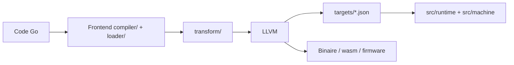

# tinygo-org/tinygo

> LLVM-based Go compiler for microcontrollers, WebAssembly and small binaries.

## The problem
The standard Go compiler produces binaries that are too large and does not target microcontrollers.

## What it actually does
It reuses the Go toolchain and LLVM libraries to compile Go to more than 150 boards (Arduino Uno, XIAO ESP32S3, etc.), to WebAssembly/WASI, or to Linux, macOS and Windows. Goals: very small binaries, good CGo support, most of the standard library. It aims neither at the speed of `gc` nor at compiling every Go program.

## How it is wired


## Trying it
```bash
tinygo flash -target arduino-uno examples/blinky1
tinygo build -buildmode=c-shared -o add.wasm -target=wasip1 add.go
```

## Cost and gotchas
Free; financial contributions requested via OpenCollective. The license is present but not automatically identified: read it before any commercial use.

## What it is not
It is not a replacement for Go: some programs do not compile, and goroutines are not optimized for large numbers.

## Alternatives
The README mentions emgo, which abandons Go's memory model.

## For you
Ignore except for edge computing: relevant for embedded Go or lightweight WASM, not for model training or inference.
