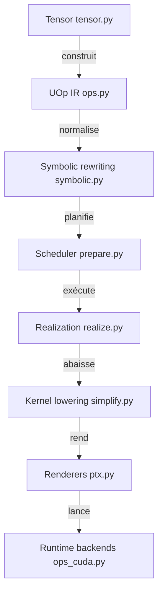

# tinygrad/tinygrad

> Minimalist deep learning stack, between PyTorch and micrograd, whose compiler stays readable.

## The problem
PyTorch hides its compiler and IR, which makes it hard to understand, optimize or port the computation to a new accelerator.

## What it actually does
A lazy tensor library with autograd, a UOps-based IR, a scheduler that fuses kernels, an optimizer using heuristics or search (BEAM) and a JIT (`TinyJit`). It also provides nn, optim and datasets. Supported accelerators include OpenCL, CPU, Metal, CUDA, AMD, NV, QCOM and WebGPU; you only need to implement about twenty low-level operations.

## How it is wired


## Trying it
```bash
git clone https://github.com/tinygrad/tinygrad.git
cd tinygrad
python3 -m pip install -e .
DEBUG=3 python3 -c "from tinygrad import Tensor; a = Tensor.empty(1024,1024); (a@a).realize()"
```

## Cost and gotchas
Free. The recommended installation is from source, not from PyPI. A GPU is not required, but it is the point of the project. Fewer functional transformations than JAX (no full vmap or pmap).

## What it is not
It is not a turnkey replacement for PyTorch in a production project: the ecosystem of models and tools is far more limited.

## Alternatives
PyTorch (full ecosystem), JAX (functional transformations) and TVM (compilation only, no framework).

## For you
Worth watching out of technical curiosity or to target an unusual accelerator; for everyday training, PyTorch remains safer.
