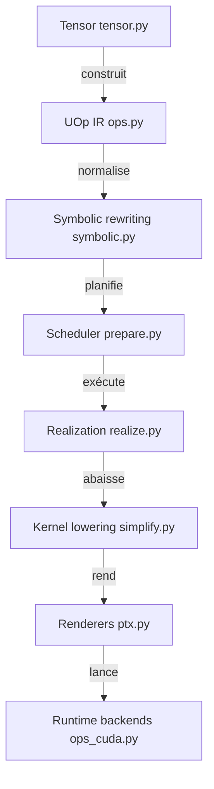

# tinygrad/tinygrad

> Pile de deep learning minimaliste, entre PyTorch et micrograd, dont le compilateur reste lisible.

## Le problème
PyTorch cache son compilateur et son IR, ce qui rend difficile de comprendre, d'optimiser ou de porter le calcul sur un nouvel accélérateur.

## Ce que ça fait vraiment
Une bibliothèque de tenseurs paresseux avec autograd, un IR à base d'UOps, un ordonnanceur qui fusionne les noyaux, un optimiseur par heuristique ou recherche (BEAM) et un JIT (`TinyJit`). Elle fournit aussi nn, optim et jeux de données. Les accélérateurs gérés incluent OpenCL, CPU, Metal, CUDA, AMD, NV, QCOM et WebGPU, il suffit d'implémenter une vingtaine d'opérations bas niveau.

## Comment c'est branché


## Essayer
```bash
git clone https://github.com/tinygrad/tinygrad.git
cd tinygrad
python3 -m pip install -e .
DEBUG=3 python3 -c "from tinygrad import Tensor; a = Tensor.empty(1024,1024); (a@a).realize()"
```

## Coût et pièges
Gratuit. L'installation recommandée se fait depuis les sources, pas depuis PyPI. Un GPU n'est pas obligatoire, mais c'est l'intérêt du projet. Moins de transformations fonctionnelles que JAX (pas de vmap ni pmap complets).

## Ce que ce n'est pas
Ce n'est pas un remplaçant clé en main de PyTorch pour un projet de production : l'écosystème de modèles et d'outils est bien plus restreint.

## Alternatives
PyTorch (écosystème complet), JAX (transformations fonctionnelles) et TVM (compilation seule, sans cadre de travail).

## Pour toi
À surveiller par curiosité technique ou pour viser un accélérateur atypique ; pour entraîner au quotidien, PyTorch reste plus sûr.

