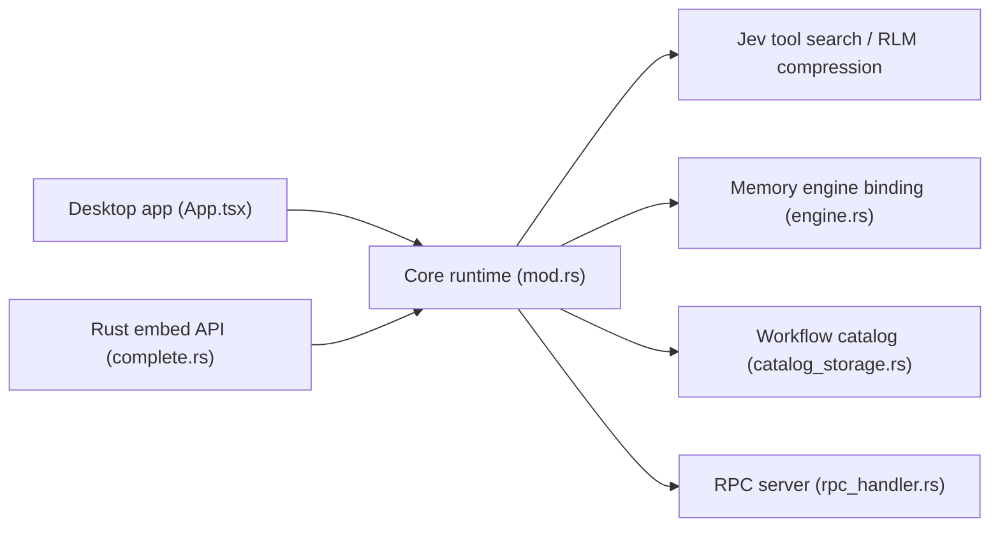

# tinyhumansai/openhuman

> Agent harness in Rust, with a desktop app and an embeddable library, for running many lightweight agents.

## The problem
Most harnesses launch one heavy process per agent and resend a large prompt on every call, which is expensive at fleet scale.

## What it actually does
A single-process Rust core with built-in memory cited on every turn, token compression (RLM), tool search (Jev), browser and desktop control, 119 OAuth apps via Composio, 14 messaging channels, durable workflows and local models or 26 providers via BYOK. As a library, `Harness::builder()` creates agents. The README claims 500 agents on a $10 VPS.

## How it is wired


## Trying it
```bash
curl -fsSL https://raw.githubusercontent.com/tinyhumansai/openhuman/main/scripts/install.sh | bash
curl -fsSL https://raw.githubusercontent.com/tinyhumansai/openhuman/main/scripts/install.sh | bash -s -- --dry-run
```

## Cost and gotchas
Provider keys are on you; the README states "early beta". GPL-3.0 license: redistribution constraints for a product embedding the library. The curl script runs remote code: run `--dry-run` first.

## What it is not
Not an independent result: the benchmark (ten SWE-bench tasks) is published by the vendor itself, on a small sample. "Number one on trending" does not prove maturity.

## Alternatives
- Claude Code, Codex, OpenClaw, Hermes Agent: harnesses compared in the README.
- openhuman-benchmarks: cited reproduction repository.

## For you
Keep an eye on it: the cost and memory figures are tempting for agent fleets, but wait for an external reproduction and check GPL compatibility.
