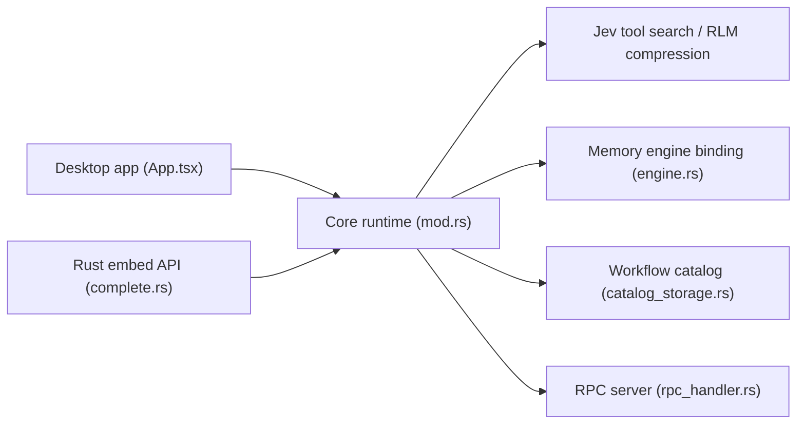

# tinyhumansai/openhuman

> Harnais d'agents en Rust, avec app de bureau et bibliothèque embarquable, pour faire tourner de nombreux agents légers.

## Le problème
La plupart des harnais lancent un processus lourd par agent et renvoient un gros prompt à chaque appel, ce qui coûte cher en fleet.

## Ce que ça fait vraiment
Un cœur Rust à processus unique avec mémoire intégrée citée à chaque tour, compression des tokens (RLM), recherche d'outils (Jev), contrôle de navigateur et de bureau, 119 apps OAuth via Composio, 14 canaux de messagerie, workflows durables et modèles locaux ou 26 fournisseurs en BYOK. En bibliothèque, `Harness::builder()` crée des agents. Le README annonce 500 agents sur un VPS à 10 $.

## Comment c'est branché


## Essayer
```bash
curl -fsSL https://raw.githubusercontent.com/tinyhumansai/openhuman/main/scripts/install.sh | bash
curl -fsSL https://raw.githubusercontent.com/tinyhumansai/openhuman/main/scripts/install.sh | bash -s -- --dry-run
```

## Coût et pièges
Clés des fournisseurs à ta charge ; le README indique une « early beta ». Licence GPL-3.0 : contraintes de redistribution pour un produit embarquant la bibliothèque. Le script curl exécute du code distant : lance d'abord `--dry-run`.

## Ce que ce n'est pas
Pas un résultat indépendant : le benchmark (dix tâches SWE-bench) est publié par l'éditeur lui-même, sur un petit échantillon. « Numéro un du trending » ne prouve pas la maturité.

## Alternatives
- Claude Code, Codex, OpenClaw, Hermes Agent : harnais comparés dans le README.
- openhuman-benchmarks : dépôt de reproduction cité.

## Pour toi
À surveiller : les chiffres de coût et de mémoire sont tentants pour des flottes d'agents, mais attends une reproduction externe et vérifie la compatibilité GPL.

