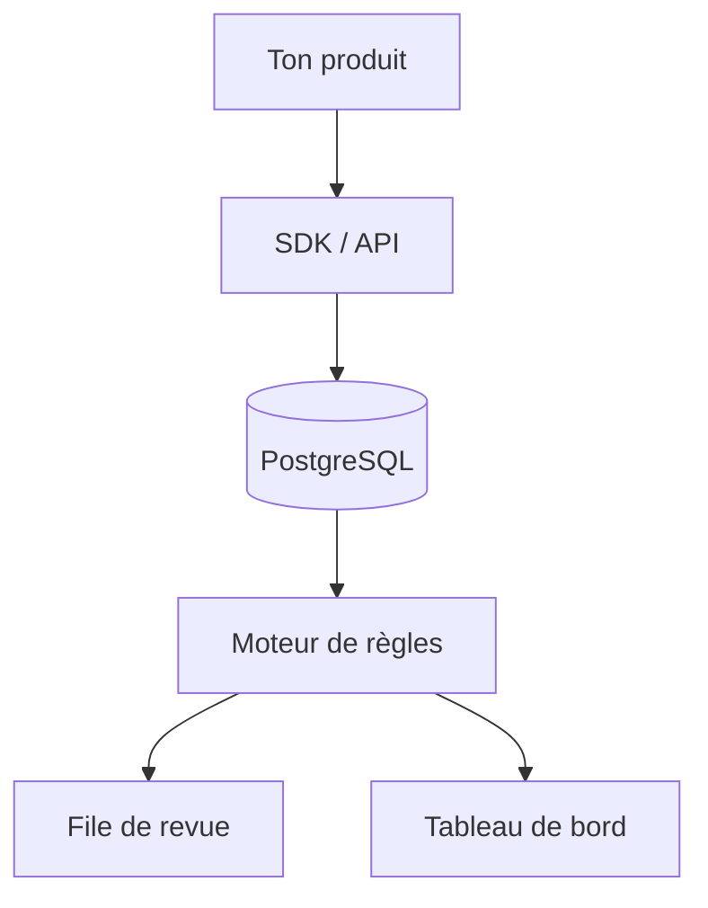

# tirrenotechnologies/tirreno

> PHP/PostgreSQL application security app that detects compromised accounts and business-logic abuse in your product.

## The problem
Firewalls, SIEMs and WAFs do not see account takeovers or application-logic abuse, which happen inside the product.

## What it actually does
You send events through an API or SDK (PHP, Python, NodeJS, WordPress). tirreno computes risk scores with a rules engine, opens a review queue that suspends or flags risky entities, keeps an audit trail of changed fields and displays everything in a dashboard with a per-user view.

## How it is wired
Simplified diagram based on the sheet, no diagram provided.


## Trying it
```bash
curl -sL tirreno.com/t.yml | docker compose -f - up -d
composer create-project tirreno/tirreno
```
A cron job every 10 minutes: `*/10 * * * * /usr/bin/php /absolute/path/to/tirreno/index.php /cron`.

## Cost and gotchas
Free. PHP 8.0 to 8.3, PostgreSQL 12+, Apache. About 3 GB of storage per million events, 4 GB of RAM recommended for PostgreSQL.

## What it is not
It is not a firewall nor a SIEM: it looks at the application events you send it. It protects nothing without SDK integration.

## Alternatives
No alternative named in the README.

## For you
Worth watching: useful for detecting abuse on an API or a service exposing your model, but you need a PHP/PostgreSQL stack to host.
