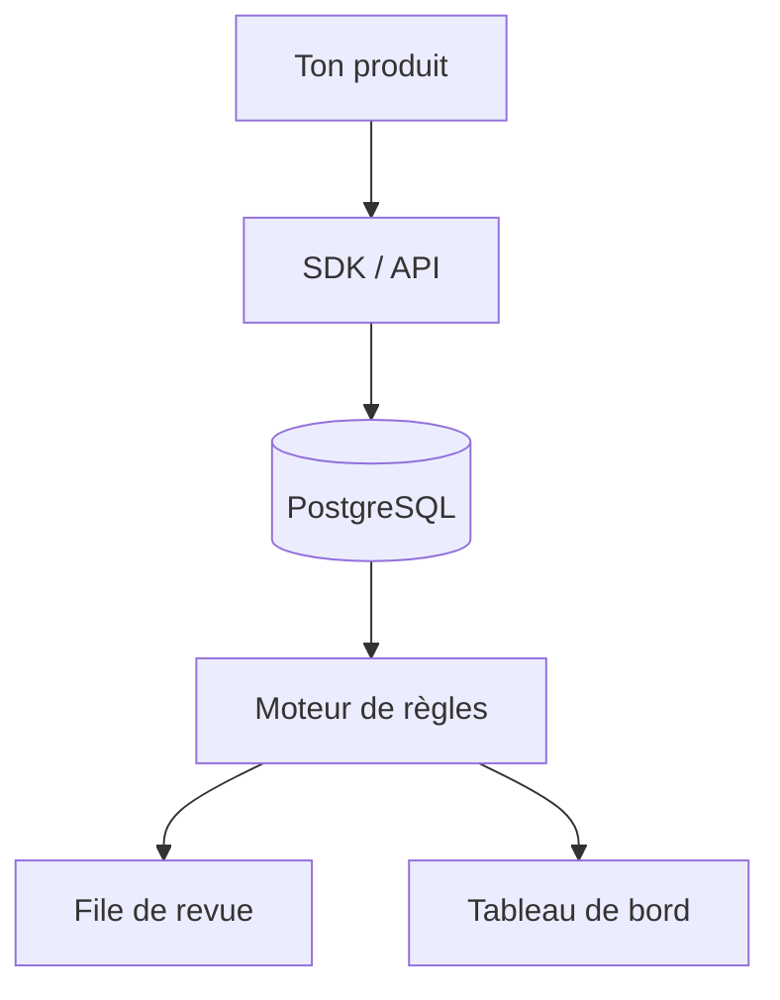

# tirrenotechnologies/tirreno

> Application PHP/PostgreSQL de sécurité applicative qui détecte comptes compromis et abus de logique métier dans ton produit.

## Le problème
Les pare-feu, SIEM et WAF ne voient pas les prises de contrôle de comptes ni les abus de logique applicative, qui se produisent à l'intérieur du produit.

## Ce que ça fait vraiment
Tu envoies des événements par API ou SDK (PHP, Python, NodeJS, WordPress). tirreno calcule des scores de risque avec un moteur de règles, ouvre une file de revue qui suspend ou signale les entités risquées, garde une piste d'audit des champs modifiés et affiche tout dans un tableau de bord avec vue par utilisateur.

## Comment c'est branché
Schéma simplifié d'après la fiche, sans diagramme fourni.


## Essayer
```bash
curl -sL tirreno.com/t.yml | docker compose -f - up -d
composer create-project tirreno/tirreno
```
Une tâche cron toutes les 10 minutes : `*/10 * * * * /usr/bin/php /absolute/path/to/tirreno/index.php /cron`.

## Coût et pièges
Gratuit. PHP 8.0 à 8.3, PostgreSQL 12+, Apache. Environ 3 Go de stockage par million d'événements, 4 Go de RAM recommandés pour PostgreSQL.

## Ce que ce n'est pas
Ce n'est pas un pare-feu ni un SIEM : il regarde les événements applicatifs que tu lui envoies. Il ne protège rien sans intégration SDK.

## Alternatives
Aucune alternative nommée dans le README.

## Pour toi
À surveiller : utile pour détecter des abus sur une API ou un service exposant ton modèle, mais il faut une pile PHP/PostgreSQL à héberger.

