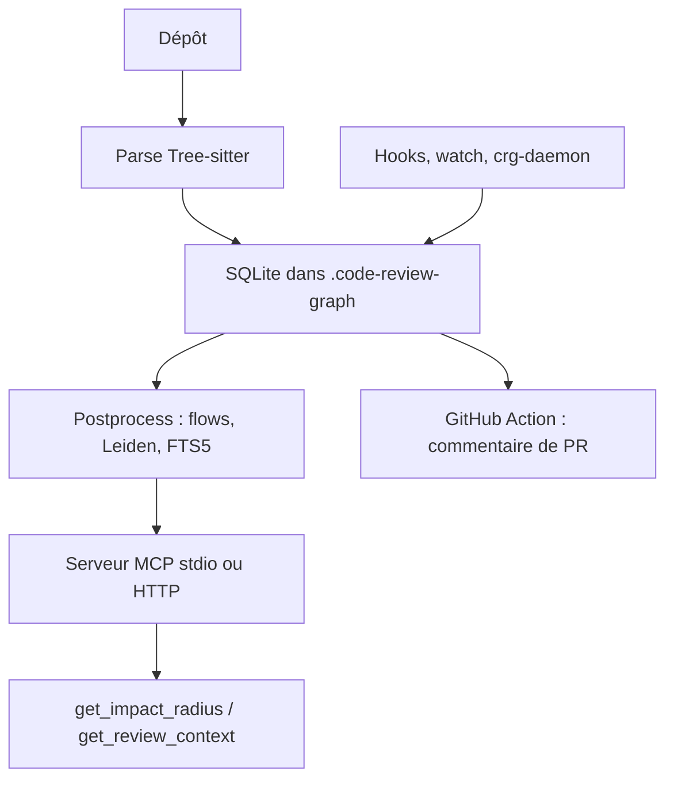

# tirth8205/code-review-graph

> Local code graph served over MCP, to give an agent the exact context of a change.

## The problem
An agent reviewing a diff rereads large parts of the repository to find who calls what.
The token cost explodes and the review still misses indirect dependencies.

## What it actually does
Parses the repository into an AST with Tree-sitter and stores it as a graph of nodes (functions, classes, imports) and edges (calls, inheritance, test coverage), in a single SQLite file under `.code-review-graph/`.
Blast radius: when a file changes, the graph traces the callers, dependents and affected tests, and the agent reads only those.
Thirty MCP tools (minimal context, impact radius, token-budgeted BFS/DFS traversal, semantic search, Leiden communities, execution flows, hub and bridge nodes, knowledge gaps, refactoring, wiki) and five workflow prompts.
Broad language coverage, custom languages via `.code-review-graph/languages.toml`, incremental updates via hooks or a multi-repo daemon, and a GitHub Action that posts a risk-scored PR comment.

## How it is wired


## Trying it
```bash
pip install code-review-graph
code-review-graph install
code-review-graph build
code-review-graph detect-changes --brief --base main
code-review-graph serve
```

## Cost and gotchas
Free, entirely local: no code is sent to an external service, including in the GitHub Action.
JSON exports contain absolute paths and structural metadata: inspect them before publishing.

## What it is not
It is not a guaranteed gain: on a trivial single-file change, the graph context can exceed a direct read, as the README says.
It is not a flawless measurement system: the 1.0 recall in impact analysis is circular (the ground truth comes from the graph itself), and the co-change mode still produces no usable measurement.
Flow detection is mostly solid in Python and PHP/Laravel; JavaScript and Go remain weak. The README provided is truncated at the optional dependency groups section.

## Alternatives
No alternative is named in the README.

## For you
An idea to keep even if you don't adopt it: index code as a graph to bound what the agent reads.
