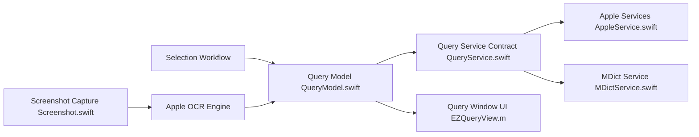

# tisfeng/Easydict

> macOS dictionary and translation app, querying several services including LLMs.

## The problem
Translating selected text or a screenshot forces you to juggle several websites and apps.

## What it actually does
Translation by typing, mouse selection, shortcut or OCR capture (Apple Vision).
Queries 20+ services in parallel: Apple Dictionary, MDict, DeepL, Google, OpenAI, Gemini, Claude, Ollama, Claude Code, Codex CLI.
Local Vapor HTTP server exposing the queries.
Swift/Objective-C code, centralized per-service key configuration.

## How it is wired


## Trying it
```bash
brew install --cask easydict
```

## Cost and gotchas
Free; the AI services require your own keys. macOS 13+ only.

## What it is not
Not a translation API to integrate into a pipeline; a desktop tool. Single maintainer, issues triaged on weekends.

## Alternatives
No alternative named in the README.

## For you
Ignore it for data/ML work: a macOS convenience tool, with no use in a pipeline.
