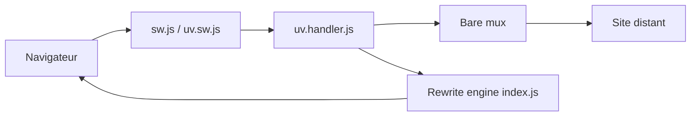

# titaniumnetwork-dev/Ultraviolet

> Browser-side web proxy based on a service worker, now superseded by Scramjet.

## The problem
Accessing a remote site through an intermediary, for example to bypass censorship or isolate browsing, requires rewriting pages and their requests on the client side.

## What it actually does
- A service worker (`sw.js`, `uv.sw.js`) intercepts the browser's HTTP requests, following the TompHTTP specifications.
- A rewriting engine transforms HTML, CSS, JavaScript, URLs and cookies (`codecs.js`) before returning the content.
- A client layer adapts the DOM, storage, workers, location and history; transport goes through bare-mux (interchangeable Bare client since v3).
- Used by several third-party projects listed in the README. The repository is no longer really maintained.

## How it is wired


## Trying it
```bash
# Ce dépôt se construit mais ne se déploie pas ; voir Ultraviolet-App pour une installation complète.
# Ancienne version non supportée :
npm install @titaniumnetwork-dev/ultraviolet@1
```

## Cost and gotchas
Free, Node required. No direct deployment from this repository. A README warning states that it is no longer maintained and that opening issues should be avoided.

## What it is not
Not a turnkey or maintained tool. A proxy of this kind can be used to bypass filtering (corporate or school networks): use must respect network rules and local law. AGPL-3.0 license.

## Alternatives
Scramjet, which replaced it according to the README.

## For you
Ignore: the project is superseded by Scramjet and has no connection to data/AI/MLOps work.
