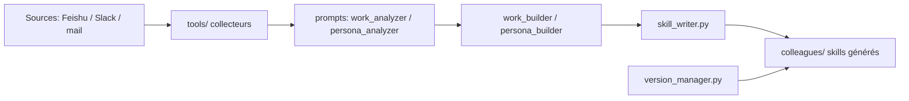

# titanwings/colleague-skill

> Agent skill that distills a person's messages and documents into a reusable profile (Distilly, formerly Colleague Skill).

## The problem
When a colleague leaves, their know-how and way of deciding disappear with them.

## What it actually does
Distilly is a skill installed in a host agent (Claude Code, Codex, OpenCode, etc.). It collects sources (Feishu, DingTalk, Slack, email, PDF, screenshots, exports), analyzes them with prompts, then produces a "Person Profile" packaged as a skill: work + personality for a colleague, relational patterns, or mental models for a public figure. Updates are appended without overwriting, with archiving and rollback.

## How it is wired


## Trying it
```bash
git clone https://github.com/titanwings/distilly <DISTILLY_SKILL_DIR>
```
Then, in the agent: "Use Distilly to create a Person Profile for …".

## Cost and gotchas
Host agent tokens are on you. Feishu collection requires adding a bot to the groups. Distilling the private life of a third party (colleague, ex, relative) raises consent and confidentiality issues that the README does not address.

## What it is not
Not a clone of the person: the README itself says it does not claim to copy them. "Demo" version according to the README.

## Alternatives
The README cites alchaincyf/karpathy-skill, one case of which is adapted.

## For you
Watch: the idea of a skill generated from sources is instructive for an AI engineer, but avoid applying it to personal data without a clear framework.
