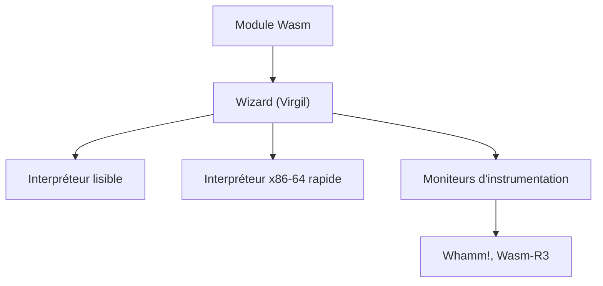

# titzer/wizard-engine

> WebAssembly virtual machine written in Virgil, designed for teaching and VM research.

## The problem
Production Wasm engines are large and hard to modify for experimenting or instrumenting.

## What it actually does
Runs Wasm bytecode in place (without rewriting) with two interpreters: a readable, portable one, and a fast one in x86-64 assembly on Linux. It compiles to a binary of about 1 MB. A baseline compiler and an optimizing compiler are announced for later.

## How it is wired
Simplified diagram based on the fiche, no diagram provided.


## Trying it
```bash
# Aucune commande documentée dans le README : voir les pages Build and Test du dépôt.
```

## Cost and gotchas
You must compile with Virgil, an uncommon language; the fast interpreter only runs on x86-64 Linux. The "most up-to-date documentation is the code".

## What it is not
Not an engine for production performance: the README says it aims at research, not maximum speed.

## Alternatives
No alternative named in the README.

## For you
Watch: interesting for anyone studying Wasm or instrumentation, but with no direct use in data/AI, and an undeclared license.
