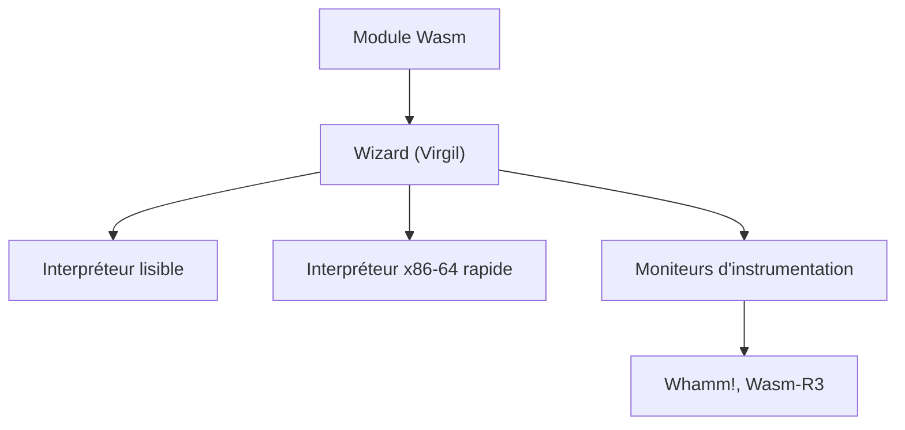

# titzer/wizard-engine

> Machine virtuelle WebAssembly écrite en Virgil, pensée pour l'enseignement et la recherche sur les VM.

## Le problème
Les moteurs Wasm de production sont gros et difficiles à modifier pour expérimenter ou instrumenter.

## Ce que ça fait vraiment
Exécute le bytecode Wasm en place (sans réécriture) avec deux interpréteurs : un lisible, portable, et un rapide en assembleur x86-64 sous Linux. Il se compile en un binaire d'environ 1 Mo. Un compilateur baseline et un compilateur optimisant sont annoncés pour plus tard.

## Comment c'est branché
Schéma simplifié d'après la fiche, sans diagramme fourni.


## Essayer
```bash
# Aucune commande documentée dans le README : voir les pages Build and Test du dépôt.
```

## Coût et pièges
Il faut compiler avec Virgil, langage peu courant ; l'interpréteur rapide ne tourne que sur x86-64 Linux. La documentation « la plus à jour est le code ».

## Ce que ce n'est pas
Pas un moteur pour la performance en production : le README dit viser la recherche, pas la vitesse maximale.

## Alternatives
Aucune alternative nommée dans le README.

## Pour toi
À surveiller : intéressant pour qui étudie Wasm ou l'instrumentation, mais sans usage direct en data/IA, et licence non déclarée.

