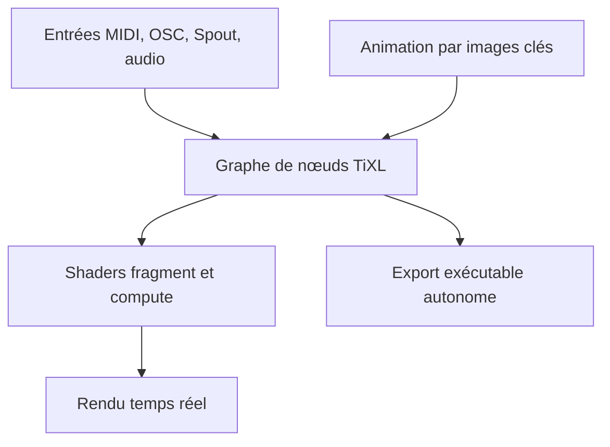

# tixl3d/tixl

> Free real-time motion design software based on a node graph, for visual artists and VJs.

## The problem
Combining real-time rendering, procedural generation and keyframe animation usually requires several separate programs.

## What it actually does
TiXL (Tooll3) combines real-time rendering, procedural graphs and animation. It aims at audio-reactive visuals, shaders (fragment and compute), MIDI, sensor, OSC or Spout input, and exports small standalone executables. Version 4 is announced as "in development" but stable enough for high-level visuals.

## How it is wired
Simplified diagram based on the sheet, no diagram provided.



## Trying it
```bash
# Aucune commande dans le README : suivre le guide d'installation de la documentation
```

## Cost and gotchas
Free (MIT). Installation and hardware requirements (GPU likely) point to external documentation, not detailed here.

## What it is not
Not a data tool nor an AI generative video tool: it is a graphic creation environment. The README says nothing about the supported platform.

## Alternatives
No alternative cited in the README.

## For you
Ignore: outside the data, AI and MLOps scope; keep only for real-time artistic visualizations.
