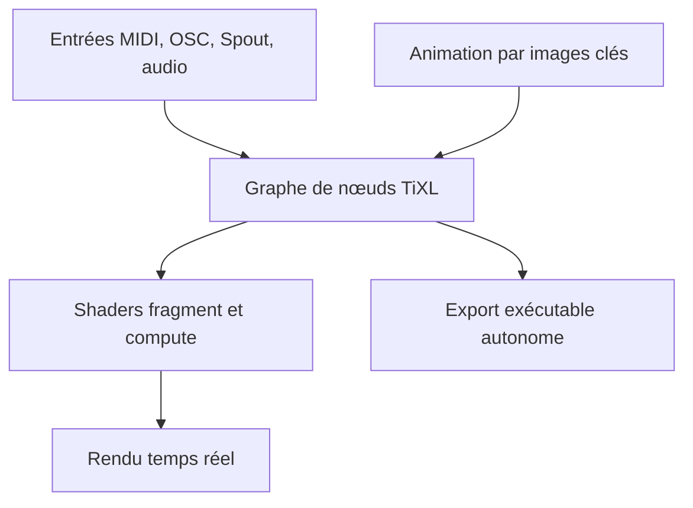

# tixl3d/tixl

> Logiciel libre de motion design temps réel par graphe de nœuds, pour artistes visuels et VJ.

## Le problème
Combiner rendu temps réel, génération procédurale et animation par images clés demande habituellement plusieurs logiciels distincts.

## Ce que ça fait vraiment
TiXL (Tooll3) assemble rendu temps réel, graphes procéduraux et animation. Il vise des visuels réactifs à l'audio, des shaders (fragment et compute), l'entrée MIDI, capteurs, OSC ou Spout, et exporte de petits exécutables autonomes. La version 4 est annoncée « en développement » mais assez stable pour des visuels de haut niveau.

## Comment c'est branché
Schéma simplifié d'après la fiche, sans diagramme fourni.



## Essayer
```bash
# Aucune commande dans le README : suivre le guide d'installation de la documentation
```

## Coût et pièges
Gratuit (MIT). Installation et prérequis matériels (GPU probable) renvoient à une doc externe, non détaillée ici.

## Ce que ce n'est pas
Pas un outil de données ni de vidéo générative par IA : c'est un environnement de création graphique. Le README ne dit rien de la plateforme prise en charge.

## Alternatives
Aucune alternative citée dans le README.

## Pour toi
À ignorer : hors périmètre data, IA et MLOps ; à garder seulement pour des visualisations artistiques temps réel.

