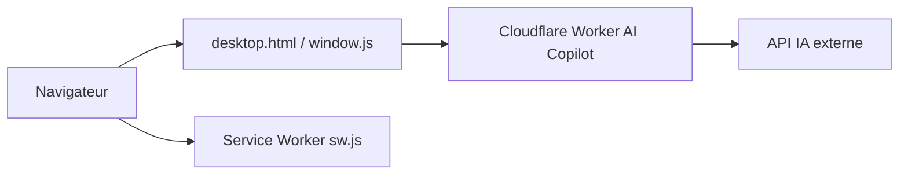

# tjy-gitnub/win12

> Former repository of a web "Windows 12" simulator, moved to win12-online/win12.

## The problem
The README contains only a notice (in Chinese): the repository was transferred to `win12-online/win12`, and no more PRs or issues should be opened here.

## What it actually does
Based on the code: a front-end PWA in HTML, CSS and JavaScript simulating a desktop (boot, windows, applications), with an offline service worker and an "AI Copilot" via a Cloudflare Worker relaying an external AI API.

## How it is wired

## Trying it
No command documented; the README points to `win12-online/win12`.

## Cost and gotchas
EPL-2.0 license. The Copilot feature depends on an external Worker and API, whose cost is not documented.

## What it is not
Not the active repository, and not a real operating system.

## Alternatives
- win12-online/win12: current repository indicated by the README.

## For you
Ignore: moved copy of a web interface demo, of no interest for data, AI or MLOps work.
