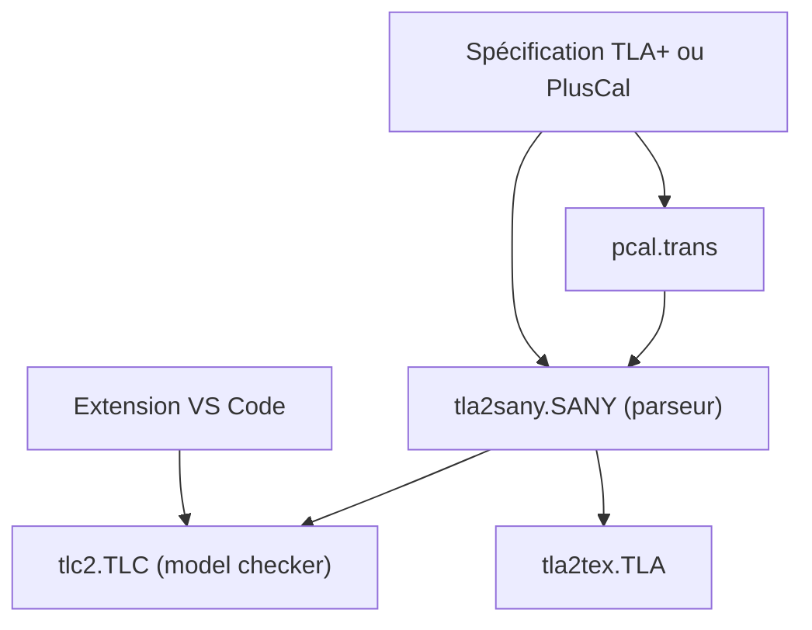

# tlaplus/tlaplus

> Command-line tools for TLA+ (parser, TLC model checker, PlusCal) to specify and verify systems.

## The problem
A distributed protocol or a state machine has rare defects that tests do not find; a verifiable specification is needed.

## What it actually does
A single jar, tla2tools.jar, bundles several tools: SANY (parser), TLC (model checker), a REPL, the PlusCal translator, a LaTeX exporter and an XML exporter. The Eclipse Toolbox is in the repository but unmaintained; a VS Code extension is recommended. Every commit on master is published as a pre-release.

## How it is wired
Simplified diagram based on the sheet, no diagram provided.


## Trying it
```bash
export CLASSPATH=tla2tools.jar
java tla2sany.SANY -help
java tlc2.TLC -help
java tlc2.REPL
java pcal.trans -help
java -jar tla2tools.jar
```

## Cost and gotchas
Free. Java 11 or later required (not in the prerequisites list). The Toolbox is unmaintained. Model checking blows up in memory on large state spaces (not documented here).

## What it is not
Not a programming language nor a testing framework: TLA+ describes a behavior, it does not generate production code.

## Alternatives
No alternative cited in the README; the TLA+ VS Code extension replaces the unmaintained Toolbox.

## For you
Watch: useful to validate an orchestration or task-queue protocol before writing it, without being an everyday data science tool.
