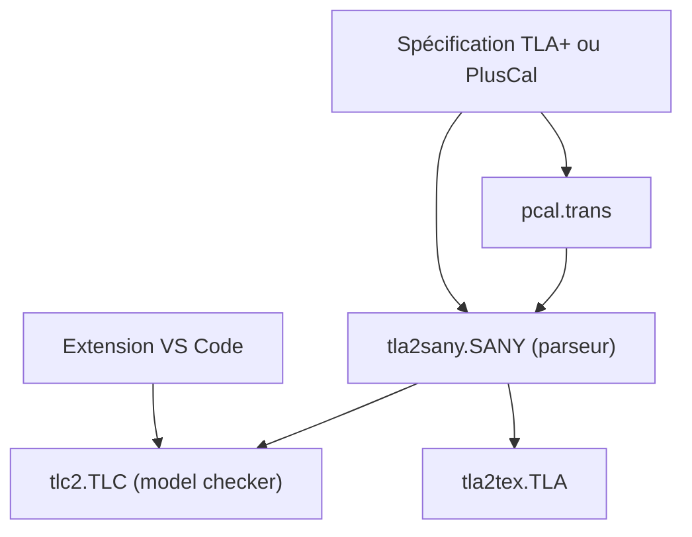

# tlaplus/tlaplus

> Outils en ligne de commande de TLA+ (parseur, model checker TLC, PlusCal) pour spécifier et vérifier des systèmes.

## Le problème
Un protocole distribué ou une machine d'états a des défauts rares que les tests ne trouvent pas ; il faut une spécification vérifiable.

## Ce que ça fait vraiment
Un seul jar, tla2tools.jar, regroupe plusieurs outils : SANY (parseur), TLC (model checker), un REPL, le traducteur PlusCal, un exporteur LaTeX et un exporteur XML. Le Toolbox Eclipse est dans le dépôt mais non maintenu ; une extension VS Code est recommandée. Chaque commit sur master est publié en pré-release.

## Comment c'est branché
Schéma simplifié d'après la fiche, sans diagramme fourni.


## Essayer
```bash
export CLASSPATH=tla2tools.jar
java tla2sany.SANY -help
java tlc2.TLC -help
java tlc2.REPL
java pcal.trans -help
java -jar tla2tools.jar
```

## Coût et pièges
Gratuit. Java 11 ou plus requis (hors liste de prérequis). Le Toolbox est non maintenu. Le model checking explose en mémoire sur de grands espaces d'états (non documenté ici).

## Ce que ce n'est pas
Pas un langage de programmation ni un framework de test : TLA+ décrit un comportement, il ne génère pas de code de production.

## Alternatives
Aucune alternative citée dans le README ; l'extension VS Code TLA+ remplace le Toolbox non maintenu.

## Pour toi
Surveiller : utile pour valider un protocole d'orchestration ou de file de tâches avant de l'écrire, sans être un outil quotidien de data science.

