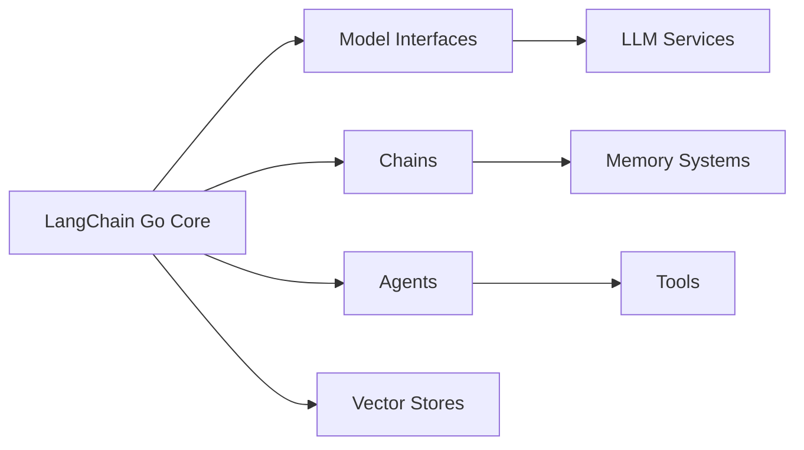

# tmc/langchaingo

> Go port of LangChain for assembling LLM applications (models, chains, agents, vector stores).

## The problem
The LangChain ecosystem is Python/JS; a Go team has to rewrite the LLM integration building blocks itself.

## What it actually does
Go library with model interfaces (`llms/openai`, Gemini, Ollama mentioned in the posts), chains, agents, memory, embeddings, vector stores, tools, document loaders, text splitters, prompts and output parsers. The README shows only one example: an OpenAI completion in a single function. The rest points to the documentation site and the `./examples` folder.

## How it is wired


## Trying it
```bash
go run .
```
(The README documents no installation command; it assumes a Go module that imports `github.com/tmc/langchaingo`.)

## Cost and gotchas
Free; the API key of the LLM provider you choose is at your expense. 415 open issues for a project carried by a personal account: check how it is followed up before committing.

## What it is not
Not an official product of LangChain Inc. nor a port with full parity: the README does not detail the functional coverage.

## Alternatives
No alternative named in the README.

## For you
Worth watching only if you have to serve LLMs from a Go backend; for Python data/AI work it brings nothing, and a single maintainer with 415 issues calls for caution.
