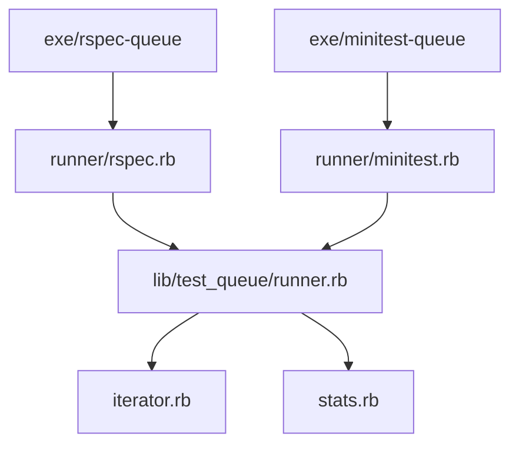

# tmm1/test-queue

> Parallel Ruby test runner with a central queue, for CI teams that want balanced workers.

## The problem
Ruby tests (RSpec, Minitest, Test::Unit) run serially or are poorly distributed across workers, and CI drags.

## What it actually does
A master opens a Unix socket and forked workers pull tests from it one by one. Each run's durations are stored locally (`.test_queue_stats`) to sort the queue on the next run. A distributed mode relays results from remote masters to a central master over TCP with a token.

## How it is wired


## Trying it
```bash
minitest-queue $(find test/ -name \*_test.rb)
rspec-queue --format progress spec
```

## Cost and gotchas
Free. Real requirement: Ruby. Workers are forks: you must isolate the database and Redis in `after_fork`, otherwise tests step on each other.

## What it is not
It is not a tool for Python or JS. It does not handle resource isolation for you.

## Alternatives
- Shopify/rails_parallel: cited in the README.
- grosser/parallel_tests: cited in the README.

## For you
Worth watching: useful only if you have a Ruby CI; a Python data / MLOps profile has no use for it.
