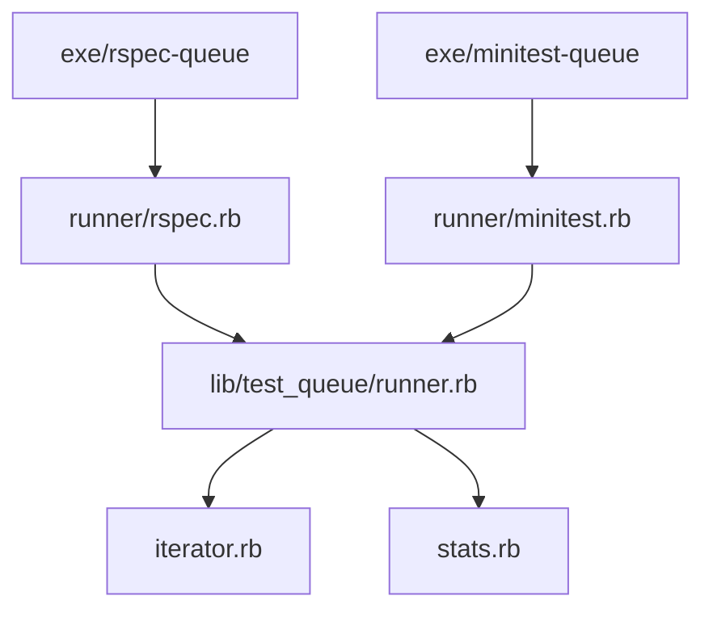

# tmm1/test-queue

> Lanceur de tests Ruby parallèle à file centrale, pour les équipes CI qui veulent des workers équilibrés.

## Le problème
Les tests Ruby (RSpec, Minitest, Test::Unit) tournent en série ou se répartissent mal entre workers, et la CI traîne.

## Ce que ça fait vraiment
Un maître ouvre un socket Unix et des workers créés par fork y piochent les tests un à un. Les durées de chaque run sont stockées localement (`.test_queue_stats`) pour trier la file au run suivant. Un mode distribué relaie les résultats de maîtres distants vers un maître central via TCP et un jeton.

## Comment c'est branché


## Essayer
```bash
minitest-queue $(find test/ -name \*_test.rb)
rspec-queue --format progress spec
```

## Coût et pièges
Gratuit. Besoin réel : Ruby. Les workers sont des forks : il faut isoler base de données et Redis dans `after_fork`, sinon les tests se marchent dessus.

## Ce que ce n'est pas
Ce n'est pas un outil pour Python ou JS. Il ne gère pas l'isolation des ressources à ta place.

## Alternatives
- Shopify/rails_parallel : cité dans le README.
- grosser/parallel_tests : cité dans le README.

## Pour toi
À surveiller : utile seulement si tu as une CI Ruby ; un profil data / MLOps en Python n'en a pas l'usage.

