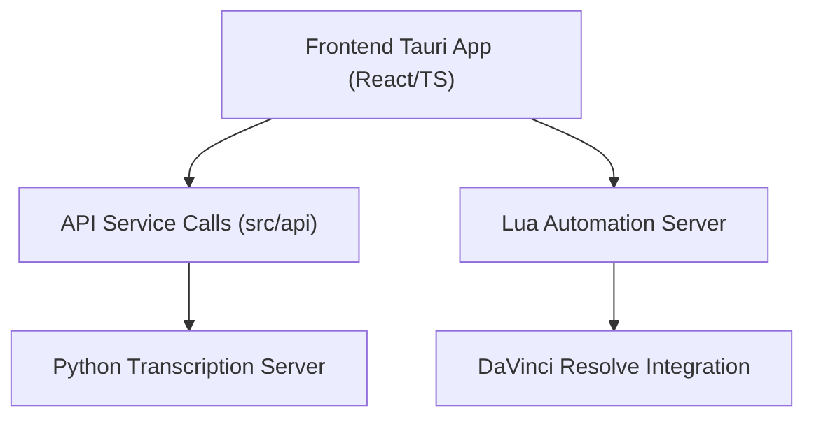

# tmoroney/auto-subs

> Local AI subtitling application, standalone or plugged into DaVinci Resolve, Premiere Pro and After Effects.

## The problem
Subtitling a video requires a paid cloud service or manual back-and-forth in the editing software.

## What it actually does
Transcribes audio and video locally, with speaker labels (diarization) and translation. Several engines to choose from: Whisper, Moonshine, Parakeet, SenseVoice, Canary, Cohere, GigaAM, Omni-ASR (1600 languages). Exports SRT or text, sends styled subtitles to Resolve, Premiere and After Effects. A CLI exists.

## How it is wired
Diagram taken from the one provided.



## Trying it
```bash
brew install --cask auto-subs
wget https://github.com/tmoroney/auto-subs/releases/latest/download/AutoSubs-linux-x86_64.deb
sudo apt install ./AutoSubs-linux-x86_64.deb
```

## Cost and gotchas
Free and offline, but models must be downloaded (up to 3.7 GB) and need 1 to 10 GB of RAM depending on the choice. The MMS alignment weights are under CC BY-NC 4.0, non-commercial.

## What it is not
Not a cloud service. The provided diagram describes an older architecture with a Python server, whereas the current README talks about Rust engines: it may be outdated.

## Alternatives
No alternative named in the README (whisper-rs and transcribe-rs are its building blocks).

## For you
Worth watching: a good testbed for comparing speech recognition models locally, with a caveat on the non-commercial license of some weights.
