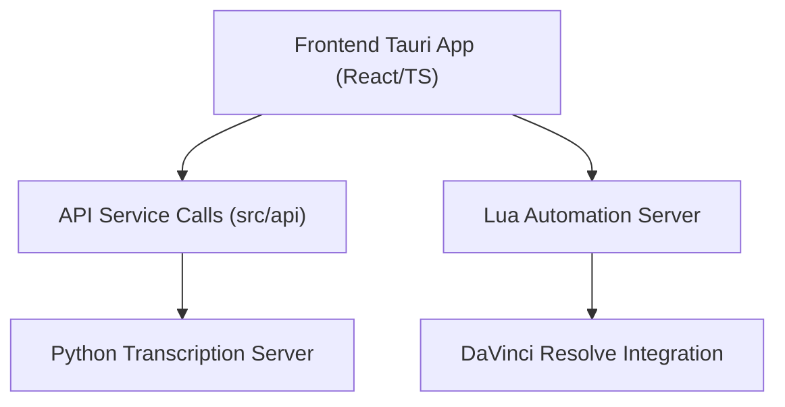

# tmoroney/auto-subs

> Application locale de sous-titrage par IA, autonome ou branchée sur DaVinci Resolve, Premiere Pro et After Effects.

## Le problème
Sous-titrer une vidéo demande un service cloud payant ou des allers-retours manuels dans le logiciel de montage.

## Ce que ça fait vraiment
Transcrit audio et vidéo en local, avec étiquettes de locuteurs (diarisation) et traduction. Plusieurs moteurs au choix : Whisper, Moonshine, Parakeet, SenseVoice, Canary, Cohere, GigaAM, Omni-ASR (1600 langues). Export SRT ou texte, envoi des sous-titres stylés vers Resolve, Premiere et After Effects. Une CLI existe.

## Comment c'est branché
Schéma d'après le diagramme fourni.



## Essayer
```bash
brew install --cask auto-subs
wget https://github.com/tmoroney/auto-subs/releases/latest/download/AutoSubs-linux-x86_64.deb
sudo apt install ./AutoSubs-linux-x86_64.deb
```

## Coût et pièges
Gratuit et hors ligne, mais les modèles se téléchargent (jusqu'à 3,7 Go) et demandent 1 à 10 Go de RAM selon le choix. Les poids d'alignement MMS sont sous CC BY-NC 4.0, non commercial.

## Ce que ce n'est pas
Pas un service cloud. Le diagramme fourni décrit une ancienne architecture avec serveur Python, alors que le README actuel parle de moteurs Rust : il peut être périmé.

## Alternatives
Aucune alternative nommée dans le README (whisper-rs et transcribe-rs sont ses briques).

## Pour toi
À surveiller : bon banc d'essai pour comparer des modèles de reconnaissance vocale en local, avec réserve sur la licence non commerciale de certains poids.

