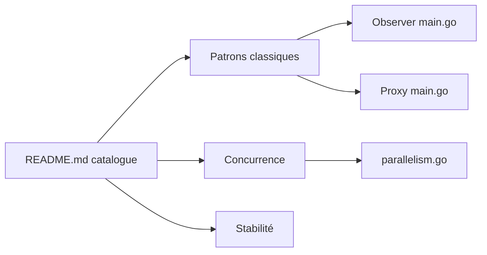

# tmrts/go-patterns

> Collection of idiomatic design and application patterns in Go, for Go developers who are learning.

## The problem
Classic patterns are described for Java or C++; their idiomatic form in Go is not obvious.

## What it actually does
A catalog in tables (creational, structural, behavioral, synchronization, concurrency, messaging, stability, profiling, idioms, anti-patterns) with a ✔ or ✘ status per pattern. Many are still to be written (✘). Runnable Go examples exist for Observer, Proxy, Parallelism and Bounded Parallelism.

## How it is wired

## Trying it
No documented command: you read the catalog and the examples.

## Cost and gotchas
Free. Last push in May 2024, and most patterns are undocumented.

## What it is not
Not a reusable library: these are examples to read. The catalog is incomplete.

## Alternatives
No alternative named in the README.

## For you
Watch: useful for learning Go concurrency patterns; partial coverage and rarely updated.
