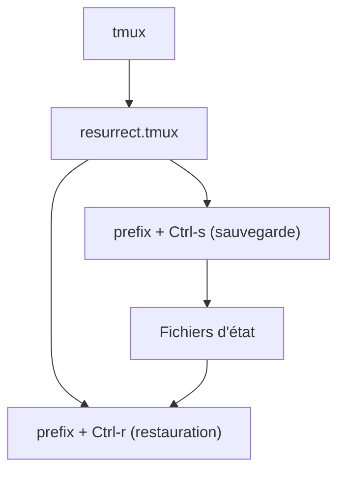

# tmux-plugins/tmux-resurrect

> tmux plugin that saves and restores sessions, windows and panes after a restart, for tmux users.

## The problem
Rebooting the machine loses all of tmux's programs, directories and pane layouts.

## What it actually does
Saves sessions, windows, panes, current directories, exact layouts and running programs. Optionally also restores vim/neovim sessions and pane contents. Idempotent: it does not recreate what already exists. Only a cautious list of programs is relaunched (vi, vim, htop, man, tail...).

## How it is wired
Simplified diagram based on the sheet, no diagram provided.



## Trying it
```bash
set -g @plugin 'tmux-plugins/tmux-resurrect'
git clone https://github.com/tmux-plugins/tmux-resurrect ~/clone/path
run-shell ~/clone/path/resurrect.tmux
tmux source-file ~/.tmux.conf
```
The first line goes in `.tmux.conf` (TPM, then `prefix + I`); the following ones form the manual installation.

## Cost and gotchas
Free. Requires tmux 1.9 or later and bash. Last push August 2024; 310 open issues.

## What it is not
Not an automatic backup: you have to trigger the save (or add tmux-continuum). It does not restore the internal state of arbitrary programs.

## Alternatives
- tmux-continuum: automatic, continuous saving and restoring.

## For you
Adopt if you work on GPU servers or long tmux sessions: getting your panes back after a reboot saves you from losing context. Maintenance has slowed, but the scope is stable.
